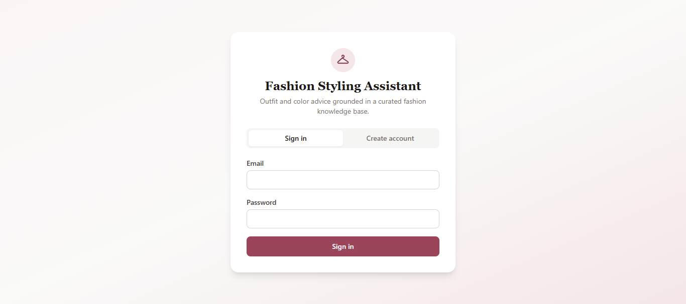
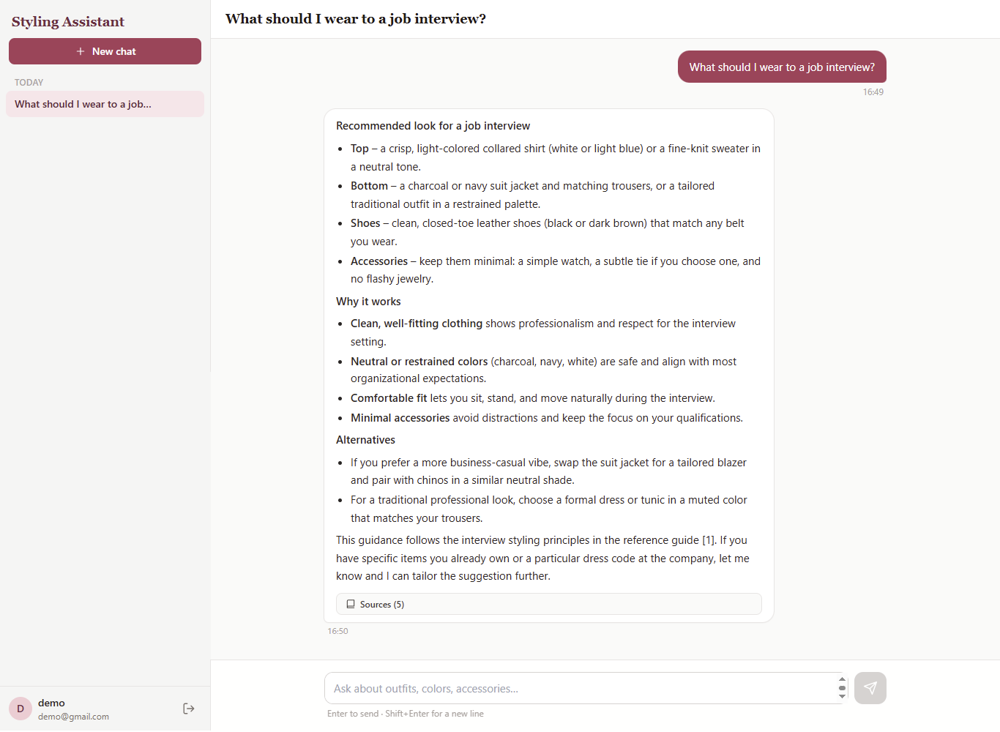
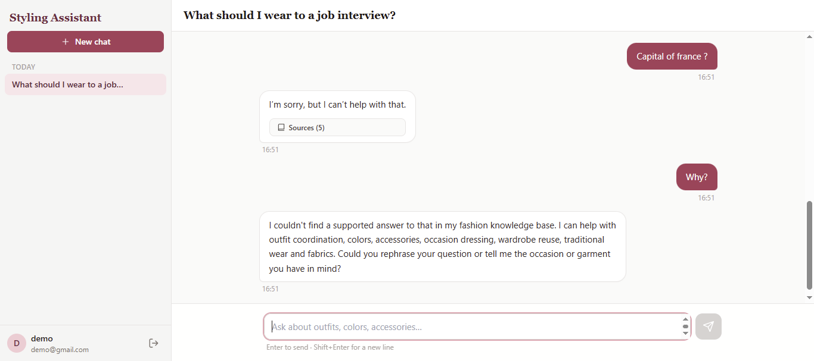
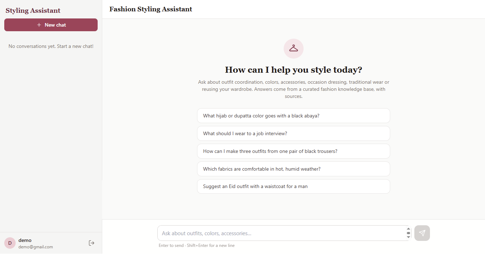
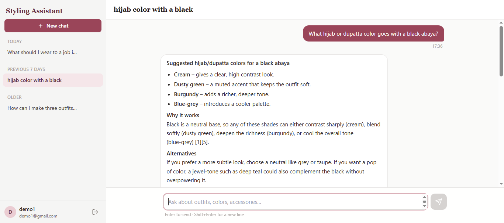

# Fashion Styling Assistant - RAG Chatbot

A multi-user chatbot that answers fashion and outfit questions from a curated knowledge base (10 Markdown
documents), with sign-in, saved conversations, a grouped history sidebar and source references.

**Stack:** Python 3.12 + FastAPI + Pydantic · MongoDB Atlas (PyMongo) · Qdrant (vectors) · Gemini embeddings ·
Groq LLM · React 18 + Vite + Tailwind CSS 3.

## How it works

```
React UI ──HTTP + Bearer JWT──> FastAPI
                                  ├─ MongoDB Atlas : users, conversations, messages, revoked tokens
                                  └─ chat turn:  save user msg → embed question (Gemini)
                                                 → Qdrant similarity search (cosine, threshold, per-doc cap)
                                                 → grounded prompt → Groq LLM → save answer + sources
Knowledge files ──scripts.ingest (separate from the API)──> chunk → embed → Qdrant
```

* **Qdrant** owns the vectors and chunk text. **MongoDB** owns users and chat data (it stores only source
  *references*, never vectors). Nothing is duplicated between them.
* If retrieval finds nothing above the relevance threshold, the bot says it cannot find a supported answer
  and **does not call the LLM**. If the LLM/Qdrant/embedding service fails, the user's message stays saved
  (marked failed) and the UI offers **Retry**; no fake answer is ever stored.

## Folder structure

```
fashion-rag-chatbot/
├── README.md
├── docs/requirements-checklist.md
├── backend/
│   ├── app/
│   │   ├── main.py                    app factory, CORS, startup (index creation)
│   │   ├── deps.py                    bearer-token auth dependency
│   │   ├── core/    config.py (env settings) · security.py (Argon2, JWT) · errors.py (safe JSON errors)
│   │   ├── db/      mongo.py · qdrant.py  (one shared client each)
│   │   ├── routers/ auth.py · conversations.py · chat.py · health.py
│   │   ├── schemas/ auth.py · conversation.py · chat.py · knowledge.py   (Pydantic)
│   │   ├── services/ auth · conversation · chat · retrieval · embedding · llm · prompts
│   │   └── ingestion/ loader.py · chunker.py · indexer.py
│   ├── scripts/  ingest.py · check_connections.py · eval_retrieval.py
│   ├── data/knowledge/  01..10 *.md + manifest.json      data/eval_questions.json
│   ├── tests/    (45 automated tests)
│   ├── requirements.txt · requirements-dev.txt · .env.example
└── frontend/
    ├── src/  api/ · context/ · hooks/ · utils/ · components/{auth,chat,layout,common}
    ├── package.json · tailwind.config.js · vite.config.js · .env.example
```

## 1. Get your service credentials (never commit them)

**MongoDB Atlas** (free M0 cluster)
1. cloud.mongodb.com → create a project → **Create** a free **M0** cluster.
2. *Database Access* → add a database user (username + password). Avoid special characters in the password,
   or URL-encode them.
3. *Network Access* → **Add IP Address** → "Add Current IP Address" (use `0.0.0.0/0` only for short demos).
4. *Database* → **Connect** → **Drivers** → copy the `mongodb+srv://...` string, replace `<db_password>`.

**Qdrant Cloud** (free cluster)
1. cloud.qdrant.io → create a free cluster → copy the **cluster URL** (ends with `:6333`) and create an **API key**.
   (A local Qdrant server such as `http://localhost:6333` also works.)

**Gemini** (embeddings): create a key at aistudio.google.com/apikey. **Groq** (LLM): create a key at console.groq.com/keys.

## Screenshots

| Sign in | Grounded answer with sources |
|---|---|
|  |  |

| Out-of-scope question | Sources List |
|---|---|
|  |  |

| Converstaion-History | 
|  |
## 2. Backend setup

```bash
cd backend
python -m venv .venv
# Windows PowerShell:   .venv\Scripts\Activate.ps1        macOS/Linux:   source .venv/bin/activate
pip install -r requirements.txt
# Windows: copy .env.example .env        macOS/Linux: cp .env.example .env
```
Edit `backend/.env` and fill every `<placeholder>`. Generate the JWT secret with:
`python -c "import secrets; print(secrets.token_urlsafe(48))"`

**Verify every connection** (prints OK/FAIL per service, never prints secrets):
```bash
python -m scripts.check_connections
```
Common failures: *MongoDB* → IP not allowed in Atlas Network Access, wrong password, or special characters not
URL-encoded. *Qdrant* → URL missing `:6333` or wrong API key. *Gemini/Groq* → key typo, or model name not available
to your account (change `EMBEDDING_MODEL` / `LLM_MODEL`).

## 3. Index the knowledge base

```bash
python -m scripts.ingest --dry-run   # chunk only: shows every chunk, needs no keys or network
python -m scripts.ingest             # create collection, embed, upsert (safe to re-run)
```
* Re-running skips unchanged chunks (no re-embedding), updates edited ones and deletes chunks whose section was removed.
* If you change `EMBEDDING_MODEL` or `EMBEDDING_DIMENSIONS`, ingestion refuses to mix vectors and tells you to run
  `python -m scripts.ingest --recreate`.
* Adding a file: put it in `data/knowledge/`, add it to `manifest.json`, re-run ingest.

**Measure retrieval and calibrate the threshold** (uses your real embeddings):
```bash
python -m scripts.eval_retrieval
```
It prints Recall@k and MRR for 11 in-scope questions plus the best score of 4 out-of-scope questions, and suggests
a `MIN_RELEVANCE_SCORE`. **The default (0.55) is a placeholder: run this once and update `.env`.**

## 4. Run the backend

```bash
uvicorn app.main:app --reload --port 8000
```
Open http://localhost:8000/docs (interactive API) and http://localhost:8000/api/health.

## 5. Run the frontend

```bash
cd frontend
npm install
# Windows: copy .env.example .env        macOS/Linux: cp .env.example .env
npm run dev
```
Open http://localhost:5173. `VITE_API_BASE_URL` must match the backend URL, and that frontend origin must be listed in
the backend's `CORS_ORIGINS`.

## Data model

**MongoDB (database `fashion_chatbot`) is the source of truth for application data.**

| Collection | Main fields | Indexes |
|---|---|---|
| `users` | `_id`, `name`, `email` (lowercase), `password_hash` (Argon2id), `created_at`, `updated_at` | unique `email` |
| `conversations` | `_id`, `user_id`, `title`, `title_source` (default/auto/user), `created_at`, `updated_at`, `last_message_at` | `(user_id, last_message_at desc)` |
| `messages` | `_id`, `conversation_id`, `user_id`, `role` (user/assistant), `content`, `status` (pending/answered/failed/ok), `created_at`, `retrieval` (grounded flag, source references, model) | `(conversation_id, created_at)` |
| `revoked_tokens` | `jti`, `expires_at` | unique `jti`, TTL on `expires_at` |

**Qdrant collection `fashion_knowledge`** holds only knowledge-base vectors: 768 dimensions, cosine distance.
Payload per point: `document_id`, `chunk_id`, `source`, `title`, `section`, `category`, `retrieval_role`, `audience`,
`language`, `access_scope`, `chunk_index`, `token_estimate`, `content_hash`, `text`, `embedding_model`,
`embedding_dimensions`. The collection is created automatically by `python -m scripts.ingest`; it holds no user or chat data.

## 6. API summary

| Method | Path | Purpose |
|---|---|---|
| POST | `/api/auth/register` | Create account (validated, email unique, password hashed with Argon2id) |
| POST | `/api/auth/login` | Returns a bearer JWT |
| POST | `/api/auth/logout` | Revokes the token server-side |
| GET | `/api/auth/me` | Current user |
| POST | `/api/conversations` | New conversation |
| GET | `/api/conversations?limit&offset` | Own conversations, newest activity first |
| GET | `/api/conversations/{id}?limit&before` | Messages (oldest→newest, paginated) |
| PATCH | `/api/conversations/{id}` | Rename |
| DELETE | `/api/conversations/{id}` | Delete conversation + messages |
| POST | `/api/conversations/{id}/messages` | Send message → RAG answer with sources (`retry_message_id` to retry) |
| GET | `/api/health` | MongoDB / Qdrant status |

Errors are always `{"detail": "...", "code": "..."}`; other users' or unknown ids return 404.

## 7. Testing

```bash
cd backend && pip install -r requirements-dev.txt && python -m pytest -q    # 45 tests
cd frontend && npm test                                                     # date-grouping tests
```
The automated tests use in-memory MongoDB (mongomock), in-memory Qdrant and fake embedding/LLM providers, so they
need no keys. They prove the application logic (auth, ownership, persistence, failure/retry, chunking, idempotent
ingestion, retrieval filtering). **They do not prove retrieval quality or answer quality with the real models; use
`eval_retrieval` and the manual script below for that.**

### Manual demo script (for the instructor / judges)
1. Register → you are returned to Sign in → sign in. Refresh the page: still signed in.
2. Click an example prompt (e.g. *black abaya + hijab*). Expect a loading indicator, an explained answer, and a collapsible **Sources** list naming document › section.
3. Ask a follow-up (*"what about shoes?"*): it uses the earlier context. Refresh: history is still there.
4. Ask something unrelated (*"capital of France?"*): the bot says it cannot find a supported answer.
5. Create a second chat; confirm the first chat's messages do not appear. Rename and delete a chat (with confirmation).
6. Sidebar groups: Today / Yesterday / Previous 7 Days / Older (computed in your browser's timezone).
7. Stop the backend and send a message: an error appears, your message is kept with **Retry**; restart and retry.
8. Sign out, then try opening a saved conversation URL/API call: rejected. Register a second user: sees none of the first user's chats.

## 8. Design notes (to explain your decisions)

* **Chunking:** heading-aware. A `##` section is one chunk when ≤ 400 estimated tokens; larger ones split at `###`;
  sections < 80 tokens merge with the next; a still-too-large unit splits at paragraph/sentence boundaries with a
  40-token overlap. Overlap is used only inside split sections because heading boundaries are already clean cuts.
  Each chunk is embedded as `Document title > section` + text so it makes sense alone. Result: 99 chunks from 10 files
  (estimated 60–396 tokens each). Token counts are estimates (characters ÷ 4). Values are configurable in `.env`; they
  are starting points, not claimed optimal.
* **Not indexed:** "Retrieval summary" sections (they match everything and carry no facts) and file 08's evaluation
  sections (used as the evaluation set instead).
* **Embeddings:** `gemini-embedding-001`, 768 dimensions (reduced from the 3072 default; configurable), separate
  document/query task types, vectors L2-normalised, cosine distance. Same model and dimensions are used for indexing and
  querying, enforced by the ingestion check above.
* **Retrieval:** top 10 candidates → relevance threshold → at most 2 chunks per document → top 5. Short follow-ups are
  searched together with the previous user question. Optional metadata filter (`category`) is implemented in the retrieval
  service but not exposed in the chat flow.
* **Prompt safety:** retrieved text is wrapped in `<knowledge_base>` and declared reference data, not instructions.
* **Auth:** Argon2id hashes, JWT bearer tokens (60 min default), server-side revocation on logout (TTL-indexed
  `revoked_tokens`), identical error for wrong password and unknown email.
* **Token storage trade-off:** the token lives in `localStorage` (survives refresh) which scripts on the page could read.
  Mitigations: assistant output is rendered through react-markdown (no raw HTML), short token lifetime, revocation on logout.
* **Synchronous endpoints:** FastAPI runs them in a thread pool; simpler to read and test than async everywhere and
  sufficient for a hackathon load.
* **Production:** serve both the API and the frontend over HTTPS and set `CORS_ORIGINS` to the real frontend origin.

## 9. Known limitations

* The relevance threshold was calibrated at 0.60.
* Tested manually with MongoDB Atlas, Qdrant Cloud, Gemini and Groq.
* No rate limiting, email verification or password reset. No streaming responses.
* Greeting detection is a small regex; the question-rewriting for follow-ups is a simple concatenation heuristic.
* The fashion content is general styling guidance, not authoritative research; wedding-event conventions in file 09 should be reviewed against your community's customs.
